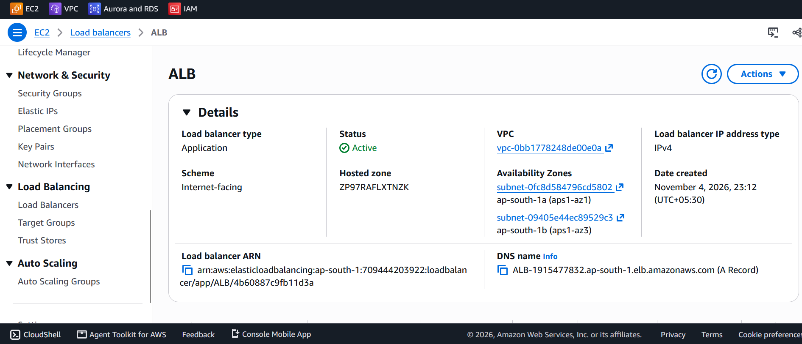
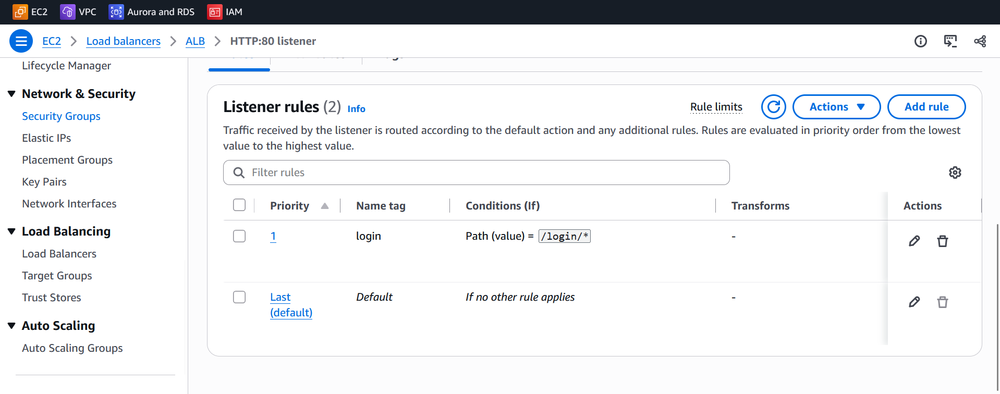
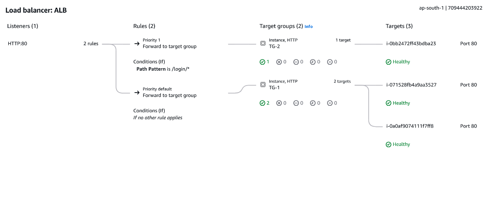

# AWS Application Load Balancer with Path-Based Routing

Configured an internet-facing **Application Load Balancer (ALB)** on AWS that routes traffic to different EC2 target groups based on the URL path.

- /login/* is forwarded to **TG-2** (1 instance, login page)
- Every other path goes to the **default** rule, which forwards to **TG-1** (2 instances, load balanced)

## Architecture

| Component | Details |
|---|---|
| Region | ap-south-1 (Mumbai) |
| Load balancer | ALB, Application type, Internet-facing, IPv4 |
| Availability Zones | ap-south-1a and ap-south-1b |
| Listener | HTTP : 80 |
| TG-1 (default) | 2 EC2 instances, port 80 |
| TG-2 (`/login/*`) | 1 EC2 instance, port 80 |
| Web server | Apache httpd on Amazon Linux |

## Steps

### 1. Launch the EC2 instances and install httpd
Launched 3 EC2 instances with HTTP (80) allowed in the security group, then on each one:

```bash
sudo yum install httpd -y
sudo systemctl start httpd
sudo systemctl enable httpd
```


### 2. Add a different page on each instance
Each instance serves its own `index.html` from `/var/www/html/` (see [script.txt](script.txt)):

| Instance | Target group | Page shown |
|---|---|---|
| Instance 1 | TG-1 | "November 19, 2023" page |
| Instance 2 | TG-1 | "June 29, 2024" page |
| Instance 3 | TG-2 | "ROHIRAT" login page |

For the path rule to work, the login page must be placed in a `login` folder, because the ALB forwards the full path `/login/` to the instance:

```bash
sudo mkdir -p /var/www/html/login
sudo nano /var/www/html/login/index.html
```

### 3. Create the target groups
Created two target groups (type: Instance, protocol: HTTP, port 80):
- **TG-1** with Instance 1 and Instance 2
- **TG-2** with Instance 3

### 4. Create the Application Load Balancer
Created an internet-facing ALB named `ALB` across two Availability Zones with an HTTP:80 listener, and set the default action to forward to **TG-1**.

****

### 5. Add the path-based routing rule
Added a listener rule on HTTP:80:

- **Priority:** 1
- **Name tag:** login
- **Condition:** Path is `/login/*`
- **Action:** Forward to **TG-2**



### 6. Verify the setup in the resource map
All 3 targets show as **Healthy**, with rule 1 routing to TG-2 and the default rule routing to TG-1.



## Testing

Open the ALB DNS name in a browser:

| URL | Expected result |
|---|---|
| `http://<alb-dns-name>/` | Page from TG-1 (alternates between the two instances on refresh) |
| `http://<alb-dns-name>/login/` | "ROHIRAT" login page from TG-2 |

**Default-path**


**Login-Path**


## What I Learned

- How an ALB distributes traffic across multiple targets
- How listener rules are evaluated by priority, with the default rule applied last
- How to route different URL paths to different target groups
- How target group health checks decide which instances receive traffic
